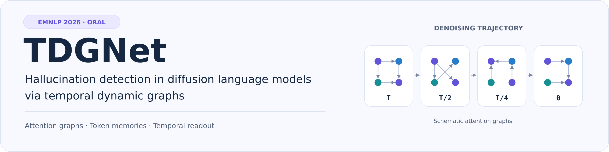
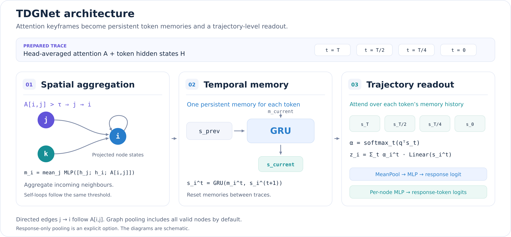

<p align="center">Arshia Hemmat · Philip Torr · Yongqiang Chen · Junchi Yu</p>

<div align="center">

[Paper](https://arxiv.org/abs/2602.08048) · [Project page](https://arshiahemmat.com/tdgnet/) · [Quickstart](#quickstart) · [Trace format](docs/trace-format.md) · [Citation](#citation)


[](LICENSE)

</div>

TDGNet models attention graphs across a diffusion language model's denoising trajectory. It maintains a memory for each token and uses temporal attention to predict hallucination at response and token level.

This package provides the detector, a prepared-trace interface, training and evaluation helpers, checkpoint utilities, and a synthetic CPU example.

## Quickstart

Use Python 3.10 or later. From the repository root:

```bash
python -m pip install -e ".[dev]"
python examples/quickstart.py
```

The example runs on synthetic traces on CPU and exercises joint training, finite loss, and checkpoint loading. To run the test suite:

```bash
python -m pytest -q
```

## Method

[](assets/tdgnet-pipeline.svg)

1. **Spatial aggregation.** Threshold head-averaged attention into directed edges `j -> i` when `A[i,j] > tau`, then average MLP messages over each node's incoming neighbours.
2. **Temporal memory.** Update a GRU memory per token in denoising order. Memory persists across keyframes within a trace and resets between traces.
3. **Trajectory readout.** Attend over each token's memory history. The resulting embeddings feed a graph classifier and a shared token classifier.

The default formulation uses one message layer, one temporal query, `hidden_dim=128`, `tau=0.05`, retained self-loops, and mean-pooling over all valid nodes. `pooling="response"` restricts graph readout to response positions. Additional message layers and temporal queries are explicit constructor options.

## Trace interface

`TraceSample` pairs K attention matrices `[N,N]` with K hidden-state matrices `[N,D]`. It also contains a response mask and optional response/token labels. `collate_traces` handles variable node counts and padding.

For T=16 denoising transitions, the default state indices are `[0,8,12,16]`, including the fully denoised endpoint. See the [trace-format guide](docs/trace-format.md) for fields, supervision, keyframe conventions and storage.

```python
from tdgnet import TDGNet, collate_traces
from tdgnet.data import load_trace

sample = load_trace("traces/example.pt")
batch = collate_traces([sample])
model = TDGNet(in_dim=sample.in_dim)
output = model(
    features=batch["features"], attentions=batch["attentions"],
    response_mask=batch["response_mask"], node_mask=batch["node_mask"],
)
# response_logit: [B]; token_logits: [B,N]
```

## Training and evaluation

Place prepared traces in training, validation and test directories:

```bash
python scripts/train.py --config configs/base.yaml \
  --train_dir traces/train --val_dir traces/val --run_dir outputs/run --device cpu
python scripts/evaluate.py --checkpoint outputs/run/best.pt \
  --test_dir traces/test --device cpu
```

Use `--task token` for token supervision or `--task joint` for both heads. Training uses BCE and Adam with validation AUROC selection. Token-only training selects on token AUROC; response/joint training selects on response AUROC.

Checkpoints preserve the complete architecture settings and trained-head state. Evaluation reports metrics only for trained heads, using the labels supplied with the traces.

## Citation

```bibtex
@misc{hemmat2026tdgnet,
  title={TDGNet: Hallucination Detection in Diffusion Language Models via Temporal Dynamic Graphs},
  author={Arshia Hemmat and Philip Torr and Yongqiang Chen and Junchi Yu},
  year={2026},
  eprint={2602.08048},
  archivePrefix={arXiv}
}
```

[MIT License](LICENSE) · [Paper and interactive examples](https://arshiahemmat.com/tdgnet/)
